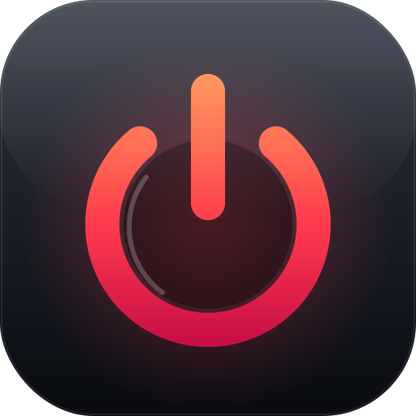

# TaskZero

A native SwiftUI menu-bar app for **closing apps and background processes** on macOS 13 Ventura or newer. Review everything that's running, pick what to close, and let TaskZero end it safely — no Activity Monitor, no `kill`, no Terminal required.

**[Website](https://ahmadfaridabbas.github.io/TaskZero/)** · **[Download](https://github.com/ahmadfaridabbas/TaskZero/releases/latest)** · macOS 13+ · Apple Silicon &amp; Intel



## 🛡️ It would rather do nothing than do harm

TaskZero only ever closes things it can prove are yours and safe to close. Every candidate passes a layered, **default-deny** check, and its identity is re-validated again in the instant before any force action — so a process it can't confidently identify is **left untouched**, never force-quit by mistake.

TaskZero **never** uses `sudo`, **never** changes SIP or Gatekeeper, **never** unloads launch agents or daemons, and **never** escalates privileges. Inspection and cleanup happen entirely on your Mac: no account, no analytics, no telemetry, no network calls.

<details>
<summary><b>Details — exactly what is eligible, and what is always protected</b></summary>

**Eligible for cleanup**

- Regular GUI applications owned by the current user with a verified Apple or Developer-ID signature.
- Developer-ID / ad-hoc signed background processes owned by the current user.

**Always protected — never targeted**

- **TaskZero itself**, and any process with an invalid PID.
- **Other users' and root-owned processes** — anything not owned by you.
- **Critical macOS session processes** — `launchd`, `WindowServer`, `loginwindow`, `Finder`, `Dock`, `SystemUIServer`, and friends.
- **Apple-signed background services** and anything in a protected system location (`/System`, `/usr/libexec`, `/sbin`, …).
- **Unknown or unverifiable identities** — if the code signature can't be confirmed, it stays protected.
- **Anything you've excluded** — a user exclusion always wins over eligibility.

**How a close actually happens**

1. `ProcessInspector` takes one `libproc` snapshot: PID, parent PID, user, executable path, start time, resource data, bundle ID, and signature metadata.
2. `ApplicationManager` discovers regular apps through `NSWorkspace.shared.runningApplications`.
3. `ProcessSafetyManager` sorts every process into *eligible*, *protected*, or *excluded* using the rules above.
4. Apps are asked to quit **gracefully** first; background processes get `SIGTERM` first.
5. Before any **force** step, TaskZero waits, then re-validates the executable path, start time, and signature. A recycled PID or changed identity is skipped — not signalled.
6. Only then, and only if you've enabled it, does it call `forceTerminate()` or send `SIGKILL`.

You can **stop a cleanup mid-run** at any time; remaining items are recorded as skipped and no new signals are sent. The entire mechanism is open source under [`TaskZero/Services/`](TaskZero/Services/).

</details>

## The panel

Everything lives in one menu-bar window — no Dock icon.

| Overview | Review &amp; clean | Process monitor |
| --- | --- | --- |
| Live counts of applications, background processes, protected items, and exclusions. | A grouped preview of what will close, with per-item selection and search. | A live, **read-only** view of every process, with filters and search. |

- **Overview** — a calm status card plus four metric tiles, a one-tap **Review & Clean**, and footer controls for History, Light/Dark, and Quit.
- **Review cleanup** — applications and background processes in separate sections, each with a real app icon, PID, and signature. Select all, clear, or search; protected and excluded items are listed but never targeted.
- **Process monitor** — inspection only; it never terminates anything. Expand a row for executable path, parent PID, user, bundle ID, signature, and team ID. Right-click to add an exclusion.
- **Report & history** — every cleanup is summarized (graceful, force, could-not-close, skipped) and the last 20 runs are kept locally.

See the full gallery on the **[website](https://ahmadfaridabbas.github.io/TaskZero/)**.

## Features

- Native SwiftUI `MenuBarExtra` panel with no Dock icon.
- **Review before you close** — a clear preview separates your apps, verified background processes, protected system services, and your exclusions.
- **Graceful first, force last** — apps are asked to quit normally; force-quit is a last resort, only for verified user-owned items, and only when you allow it.
- **Stop any time** — cancel a cleanup mid-run; remaining items are skipped.
- **Exclusions** — permanently skip VPNs, security tools, sync clients, audio services, or virtualization software, by process name or bundle identifier.
- **Bounded, validated timeouts** — graceful and force timeouts are clamped to a 1–60 s range.
- System / Light / Dark appearance, saved across launches and applied to every window.
- Local-only history of recent cleanups, with a privacy note at [`docs/Privacy.md`](docs/Privacy.md).

## Install

1. Download and extract [the latest release](https://github.com/ahmadfaridabbas/TaskZero/releases/latest).
2. Drag `TaskZero.app` to your Applications folder.
3. Because TaskZero is open source and not notarized by Apple, macOS quarantines it on download. Run this once in Terminal to let it launch:

   ```sh
   xattr -dr com.apple.quarantine /Applications/TaskZero.app
   ```
4. Click the TaskZero glyph in the menu bar to open the panel. TaskZero does **not** open a window or show a Dock icon.

This is a locally (ad-hoc) signed build, not Apple-notarized. The command above clears macOS's quarantine flag so the app opens cleanly; alternatively you can right-click → Open the first time or approve it in **System Settings → Privacy & Security**. Requires macOS 13 Ventura or later.

## Build from source

Open `TaskZero.xcodeproj` in Xcode and select the **TaskZero** scheme, or build from Terminal:

```sh
xcodebuild \
  -project TaskZero.xcodeproj \
  -scheme TaskZero \
  -configuration Release \
  -sdk macosx \
  build \
  CODE_SIGNING_ALLOWED=NO
```

Run the test suite with:

```sh
xcodebuild test \
  -project TaskZero.xcodeproj \
  -scheme TaskZero \
  -destination 'platform=macOS' \
  CODE_SIGNING_ALLOWED=NO
```

The tests use mock termination providers and never signal a real process. They cover Apple/system protection, root ownership, unknown signatures, exclusions, graceful and force termination, PID-identity revalidation, overlapping-cleanup prevention, mid-cleanup cancellation, and timeout clamping.

TaskZero is **not** sandboxed and is **not** a Mac App Store app — a process-management utility must enumerate and signal the current user's own processes, which the App Sandbox forbids. It ships `TaskZero/TaskZero.entitlements` with the sandbox explicitly disabled and builds with the **hardened runtime enabled**, so it can be Developer ID signed and notarized for distribution.

## Project structure

```text
TaskZero/
├── App/             Application lifecycle and MenuBarExtra scene
├── Models/          Codable process, settings, exclusion, and result models
├── Services/        libproc, NSWorkspace, termination, safety, persistence
├── ViewModels/      Main-actor state for menu bar, settings, and monitor
├── Views/           Menu bar, preview, report, monitor, settings, history
├── Utilities/       Signature verification, constants, process helpers
└── Resources/       Asset catalog and brand master

docs/                GitHub Pages website (served from /docs)
TaskZeroTests/       XCTest suite with mock termination providers
```

## Status &amp; licensing

TaskZero is an independent project. It uses only Apple's public process and application APIs and makes no network calls. The icon is a geometric zero with a termination mark; the master artwork lives at [`TaskZero/Resources/Branding/TaskZeroIcon.svg`](TaskZero/Resources/Branding/TaskZeroIcon.svg).

TaskZero is released under the [MIT License](LICENSE). Copyright (c) 2026 Ahmad Farid Abbas.
